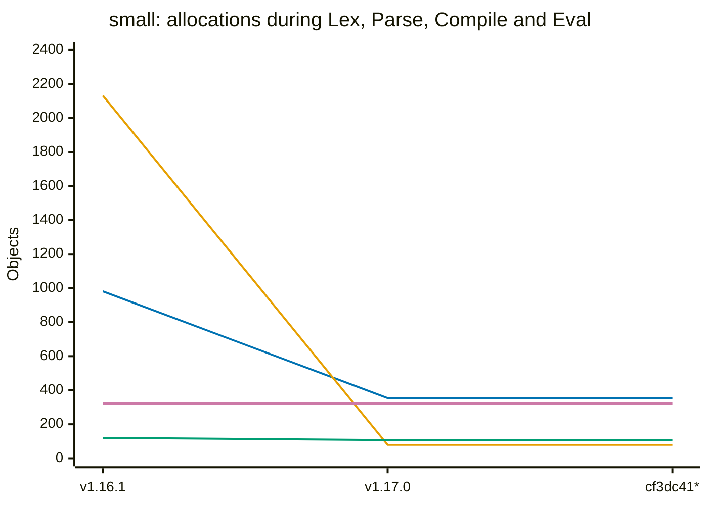
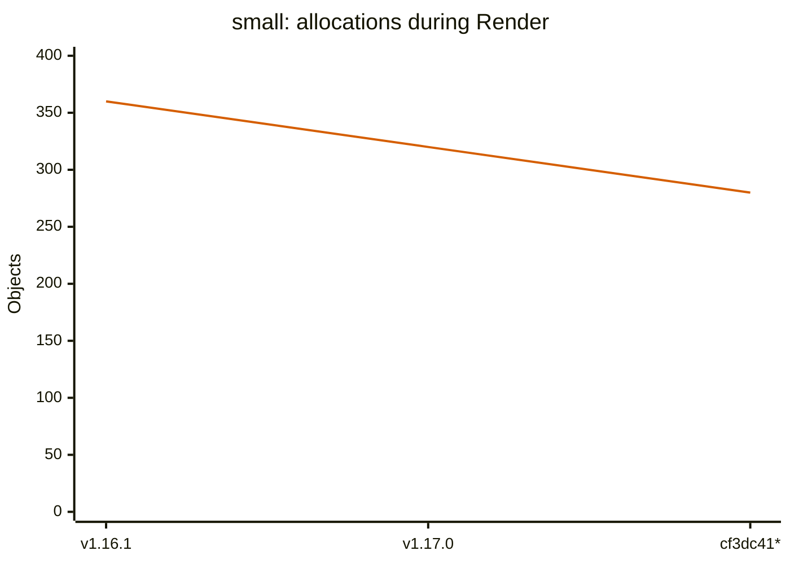
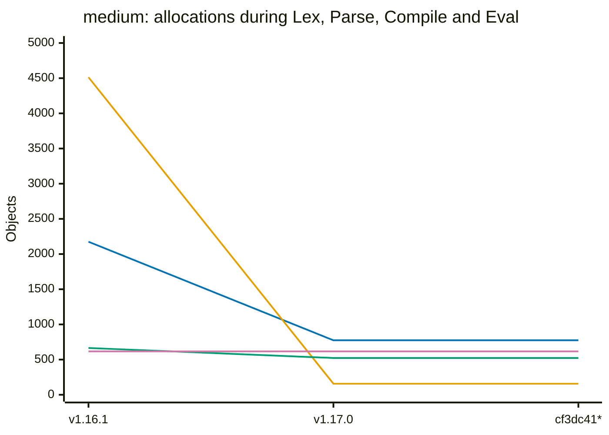
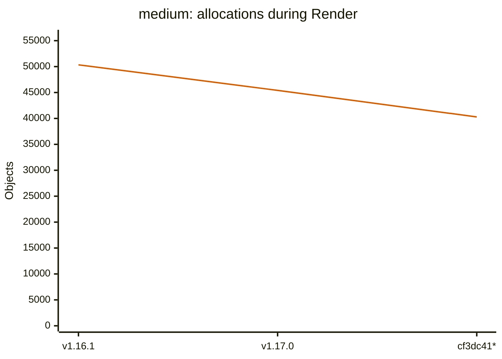
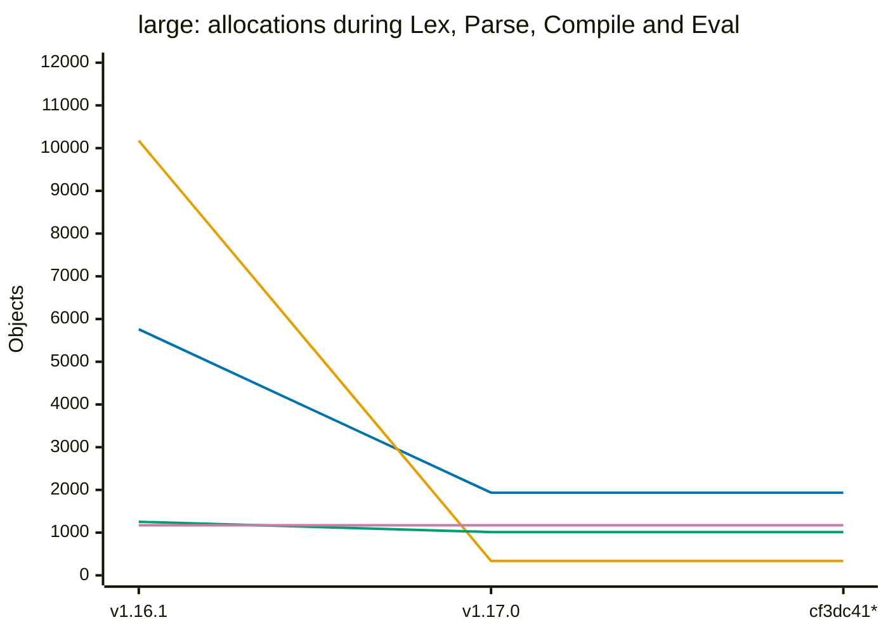
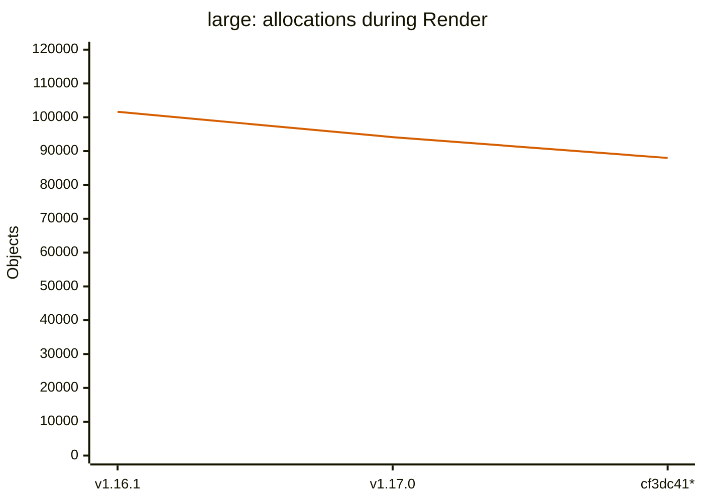
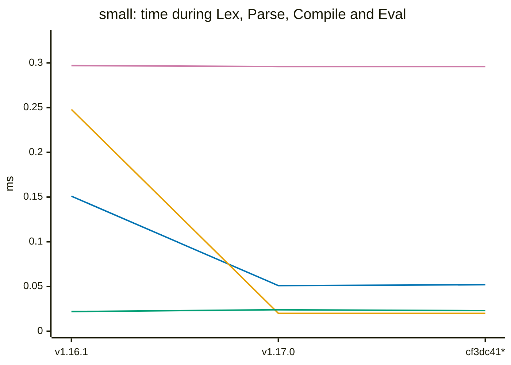
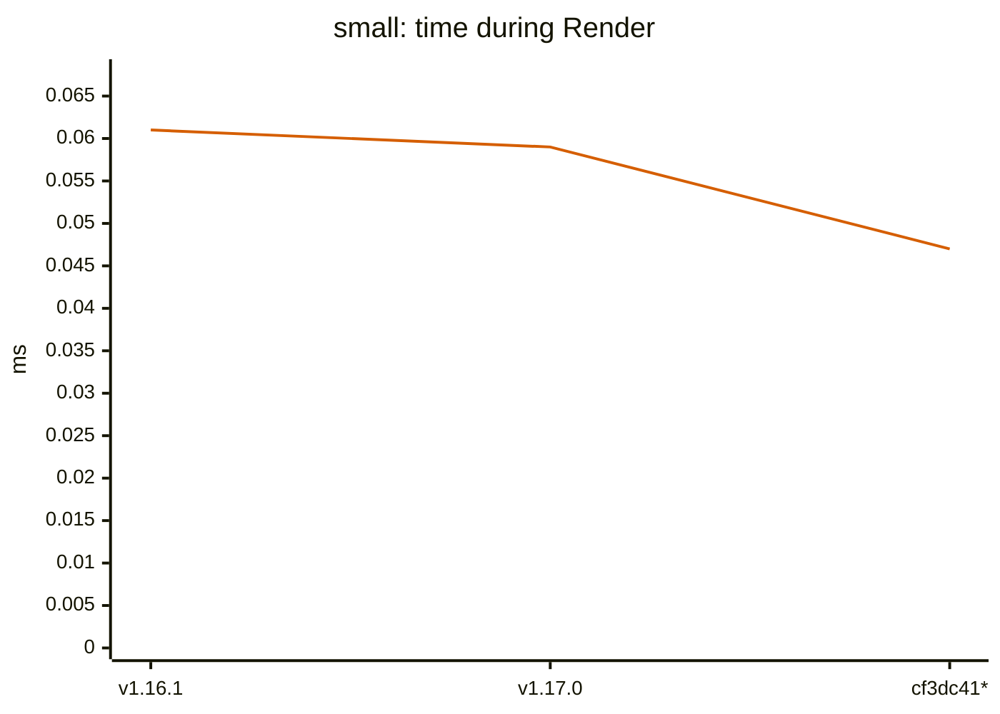
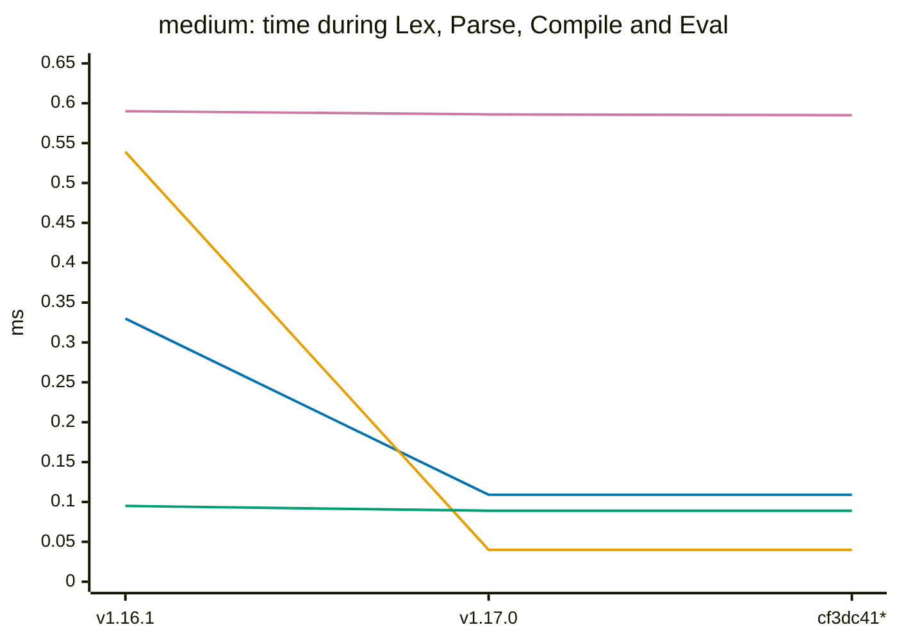
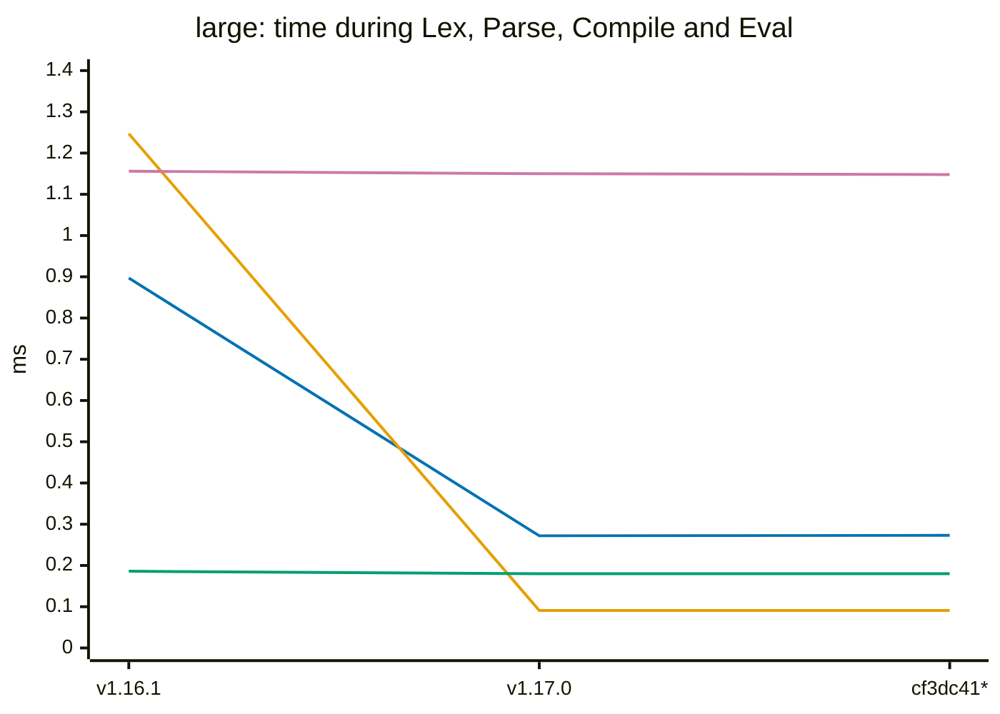

# Benchmark history

Generated from the versions of `benchmark/results.json` in the git history (following only the first parent of merges) by `bundle exec rake benchmark` or `bundle exec rake benchmark:history`. Don't edit this file by hand. The latest results, and what each step measures, are in [RESULTS.md](RESULTS.md).

Each run is labeled with the commit it measured, or the git ref (e.g. a release tag) for runs of earlier versions. `*` marks runs with uncommitted changes.

## Runs

| Run | Date | Curlybars | Ruby | YJIT | ActionView | Machine |
|---|---|---|---|---|---|---|
| v1.16.1 | 2026-11-20 | 1.16.1 | 3.4.12 | disabled | 8.1.3.1 | Apple M1 Pro, Darwin 25.6.0 arm64 |
| v1.17.0 | 2026-11-20 | 1.17.0 | 3.4.12 | disabled | 8.1.3.1 | Apple M1 Pro, Darwin 25.6.0 arm64 |
| cf3dc41* | 2026-11-20 | 1.17.0 | 3.4.12 | disabled | 8.1.3.1 | Apple M1 Pro, Darwin 25.6.0 arm64 |

## Allocations per call

Allocations don't depend on the machine, but can change with the Ruby and Rails versions (see "Runs").

### small





| Run | Lex | Parse | Compile | Eval | Render | Render with ActionView |
|---|--:|--:|--:|--:|--:|--:|
| v1.16.1 | 981 | 2,132 | 120 | 322 | 360 | 419 |
| v1.17.0 | 354 | 79 | 107 | 322 | 320 | 379 |
| cf3dc41* | 354 | 79 | 107 | 322 | 280 | 339 |

### medium





| Run | Lex | Parse | Compile | Eval | Render | Render with ActionView |
|---|--:|--:|--:|--:|--:|--:|
| v1.16.1 | 2,175 | 4,513 | 665 | 617 | 50,337 | 50,392 |
| v1.17.0 | 774 | 157 | 523 | 617 | 45,413 | 45,475 |
| cf3dc41* | 774 | 157 | 523 | 617 | 40,292 | 40,357 |

### large





| Run | Lex | Parse | Compile | Eval | Render | Render with ActionView |
|---|--:|--:|--:|--:|--:|--:|
| v1.16.1 | 5,760 | 10,175 | 1,254 | 1,172 | 101,622 | 101,679 |
| v1.17.0 | 1,935 | 338 | 1,014 | 1,172 | 94,133 | 94,190 |
| cf3dc41* | 1,935 | 338 | 1,014 | 1,172 | 87,977 | 88,031 |


## Time per call

Times are only comparable between runs on the same machine, Ruby version and YJIT setting, so they are grouped by those.

### Apple M1 Pro, Darwin arm64, Ruby 3.4.12, YJIT disabled

#### small





| Run | Lex | Parse | Compile | Eval | Render | Render with ActionView |
|---|--:|--:|--:|--:|--:|--:|
| v1.16.1 | 150.5 µs | 248.4 µs | 22.2 µs | 296.5 µs | 61.3 µs | 81.3 µs |
| v1.17.0 | 51.2 µs | 19.5 µs | 23.5 µs | 295.5 µs | 58.7 µs | 80.5 µs |
| cf3dc41* | 51.5 µs | 19.5 µs | 23.5 µs | 295.6 µs | 47.2 µs | 67.8 µs |

#### medium



```mermaid
---
config:
  themeVariables:
    xyChart:
      plotColorPalette: "#D55E00"
---
xychart-beta
  title "medium: time during Render"
  x-axis ["v1.16.1", "v1.17.0", "cf3dc41*"]
  y-axis "ms" 0 --> 18
  line "Render" [16.1, 16.19, 14.9]
```

| Run | Lex | Parse | Compile | Eval | Render | Render with ActionView |
|---|--:|--:|--:|--:|--:|--:|
| v1.16.1 | 329.8 µs | 538.9 µs | 94.7 µs | 589.7 µs | 16.10 ms | 16.12 ms |
| v1.17.0 | 108.6 µs | 40.0 µs | 89.5 µs | 585.5 µs | 16.19 ms | 16.26 ms |
| cf3dc41* | 108.8 µs | 40.0 µs | 89.2 µs | 585.0 µs | 14.90 ms | 14.78 ms |

#### large



```mermaid
---
config:
  themeVariables:
    xyChart:
      plotColorPalette: "#D55E00"
---
xychart-beta
  title "large: time during Render"
  x-axis ["v1.16.1", "v1.17.0", "cf3dc41*"]
  y-axis "ms" 0 --> 59
  line "Render" [52.9, 52.33, 50.04]
```

| Run | Lex | Parse | Compile | Eval | Render | Render with ActionView |
|---|--:|--:|--:|--:|--:|--:|
| v1.16.1 | 896.9 µs | 1.25 ms | 186.2 µs | 1.16 ms | 52.90 ms | 53.01 ms |
| v1.17.0 | 272.3 µs | 90.7 µs | 179.7 µs | 1.15 ms | 52.33 ms | 52.21 ms |
| cf3dc41* | 272.9 µs | 91.1 µs | 180.4 µs | 1.15 ms | 50.04 ms | 50.05 ms |

